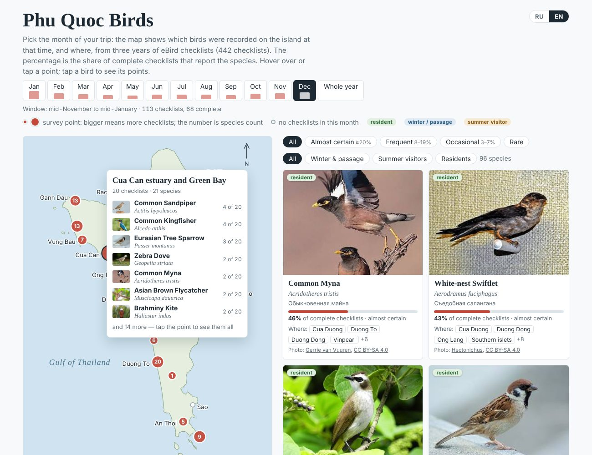

# Phu Quoc Birds

**English** · [Русский](README.ru.md)

An interactive map of the birds you can expect on Phu Quoc island (Vietnam) in any month, built from three years of eBird checklists.



**Open the map:** `https://lenadrozd.github.io/phu-quoc-birds/` (after GitHub Pages is switched on, see below). The page has a Russian / English switch in the top-right corner. The address can carry the language and month, e.g. `#en-dec`, `#ru-jun`, `#en-year`.

## What it shows

- Pick a **month** (or the whole year): the map and the list show the birds recorded on the island at that time. **167 species** in total, from three years of eBird checklists (November 2023 – September 2026, 442 checklists).
- A "month" is the calendar month plus half a month on each side (December = mid-November to mid-January). Few people go birding on Phu Quoc, and the wider window gives steadier numbers. Small bars under the month buttons show how many checklists stand behind each month.
- For each species: Russian, English and Latin names, a photo, the **share of complete checklists** that report it in the chosen month, its status (resident, winter / passage, summer visitor) and the points where it was seen.
- **27 map points**: nearby eBird locations grouped together. A bigger circle means a bigger share of the month's checklists; the number is how many species were recorded there. Hollow circles are places with no checklists in that month.

Frequency groups: *almost certain* ≥ 20 % of complete checklists, *frequent* 8–19 %, *occasional* 3–7 %, *rare* < 3 %.

### Caveats

Most checklists come from hotels and the coast. The forested north and the national park are barely surveyed, so forest species are commoner than their percentages suggest. Months from April to September have 40–60 checklists each, so treat their percentages as rough. Checklists without a precise location ("whole island") count in the percentages but are not placed on the map. Birds recorded only at Vinpearl Safari (captive), nocturnal species and an escaped South American parakeet are left out.

## Repository

```
index.html                 the map (open it in a browser, or serve with GitHub Pages)
photos/                    one small photo per species (Wikimedia Commons)
data/species_by_month.csv  one row per species: names, status, % of checklists and checklists per month
data/points.json           map points: names, coordinates, checklists and species per month
data/months.json           number of checklists behind every month
data/photo_credits.json    author, licence and source page for every photo
data/island_outline.json   coastline of Phu Quoc (geoBoundaries)
data/EBIRD_TERMS_OF_USE.txt
scripts/analyze.py         raw eBird download -> data/*.csv, *.json
scripts/build_page.py      data -> index.html
scripts/names.py           Russian names, statuses, exclusions, point names
scripts/template.html      page template
```

## Rebuilding from eBird data

The raw eBird files are **not** included: the eBird terms of use do not allow republishing them. To rebuild:

1. Request the eBird Basic Dataset for Vietnam at <https://ebird.org/data/download> (both the observations and the sampling-event files).
2. Install Python 3.10+ and `pip install -r requirements.txt`.
3. Run:

   ```
   python scripts/analyze.py --ebd raw/ebd_VN_..._relSep-2026.txt --sampling raw/ebd_VN_..._relSep-2026_sampling.txt
   python scripts/build_page.py --repo https://github.com/LenaDrozd/phu-quoc-birds
   ```

Put the downloads in `raw/`; that folder is ignored by git.

## Data, photos and credits

- **eBird.** eBird Basic Dataset. Version: EBD_relSep-2026. Cornell Lab of Ornithology, Ithaca, New York. Sep 2026. The tables in `data/` are derived from it and are shared under the same [eBird terms of use](data/EBIRD_TERMS_OF_USE.txt): non-commercial use only, with citation. This project is not endorsed by the Cornell Lab of Ornithology.
- **Photos.** Wikimedia Commons, each under its own Creative Commons or public-domain licence; author, licence and source are shown on every card and listed in `data/photo_credits.json`.
- **Coastline.** geoBoundaries, CC BY 4.0.
- **Code.** MIT licence, see [LICENSE](LICENSE). Details in [DATA_LICENSE.md](DATA_LICENSE.md).

## Publishing with GitHub Pages

Settings → Pages → *Build and deployment*: Source **Deploy from a branch**, Branch **main**, folder **/(root)** → Save. The map appears at `https://lenadrozd.github.io/phu-quoc-birds/` within a few minutes.
