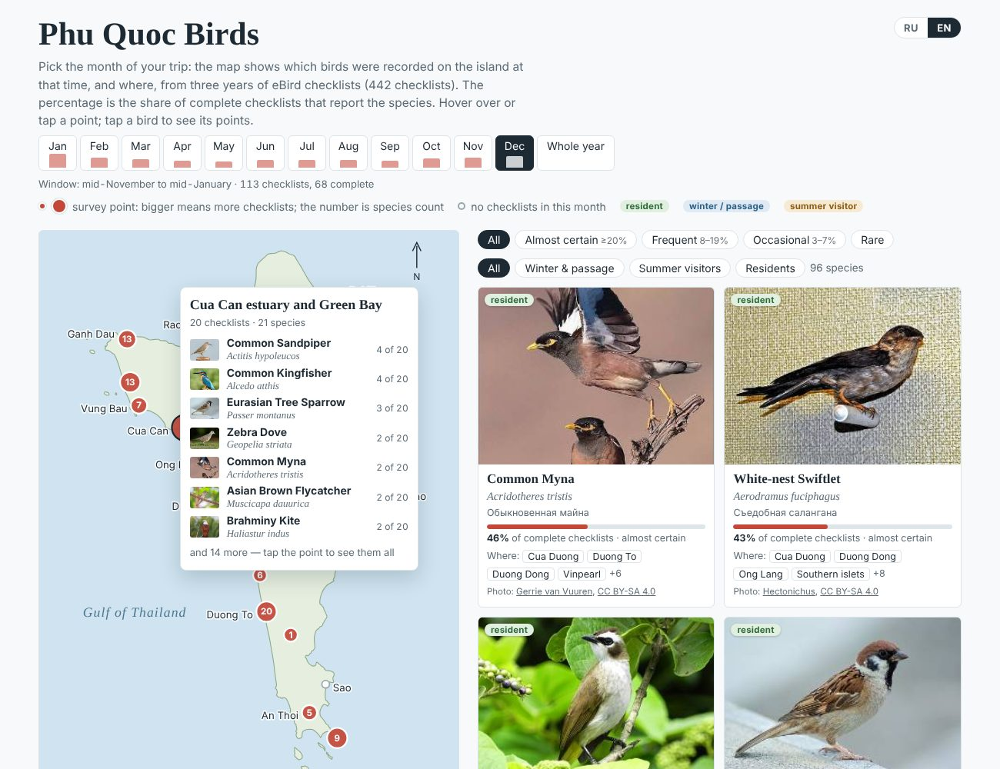

# Птицы Фукуока

[English](README.md) · **Русский**

Интерактивная карта птиц, которых можно встретить на острове Фукуок (Вьетнам) в любой месяц. Построена по спискам наблюдений eBird за три года.



**Открыть карту:** `https://lenadrozd.github.io/phu-quoc-birds/` (после включения GitHub Pages, см. ниже). Справа вверху есть переключатель «RU / EN». В адресе можно указать язык и месяц, например `#ru-dec`, `#en-jun`, `#ru-year`.

## Что на карте

- Выберите **месяц** поездки (или весь год) — карта и список покажут птиц, которых отмечали на острове в это время. Всего **167 видов** по спискам eBird за три года (ноябрь 2023 — сентябрь 2026, 442 списка).
- «Месяц» — это календарный месяц плюс по полмесяца с каждой стороны (декабрь — с середины ноября до середины января). Наблюдателей на Фукуоке мало, и широкое окно даёт более устойчивые цифры. Столбики под кнопками месяцев показывают, сколько списков стоит за каждым месяцем.
- Для каждого вида: русское, английское и латинское название, фото, **доля полных списков** за выбранный месяц, статус (круглый год, зимует или пролётом, гнездится летом) и точки, где его видели.
- **27 точек**: соседние места наблюдений eBird, собранные вместе. Чем больше кружок, тем большая доля списков месяца сделана там; число — сколько видов там отмечено. Пустые кружки — места, где в этот месяц не наблюдали.

Группы встречаемости: *почти наверняка* — от 20 % полных списков, *часто* — 8–19 %, *иногда* — 3–7 %, *редко* — меньше 3 %.

### Ограничения

Большинство списков сделано в отелях и на побережье. Лесной север и нацпарк обследованы мало, поэтому лесные виды встречаются чаще, чем говорят проценты. С апреля по сентябрь на месяц приходится 40–60 списков, так что проценты для этих месяцев приблизительные. Списки без точной точки («весь остров») учтены в процентах, но на карте не показаны. Не учтены птицы, отмеченные только в сафари-парке Vinpearl, ночные виды и сбежавший южноамериканский попугай. Русские названия многих тропических видов не устоялись — опорное латинское.

## Что в репозитории

```
index.html                 карта (откройте в браузере или опубликуйте через GitHub Pages)
photos/                    по одному небольшому фото на вид (Wikimedia Commons)
data/species_by_month.csv  строка на вид: названия, статус, % и число списков по месяцам
data/points.json           точки карты: названия, координаты, списки и виды по месяцам
data/months.json           сколько списков стоит за каждым месяцем
data/photo_credits.json    автор, лицензия и страница источника для каждого фото
data/island_outline.json   береговая линия Фукуока (geoBoundaries)
data/EBIRD_TERMS_OF_USE.txt
scripts/analyze.py         выгрузка eBird -> data/*.csv, *.json
scripts/build_page.py      данные -> index.html
scripts/names.py           русские названия, статусы, исключения, названия точек
scripts/template.html      шаблон страницы
```

## Как пересобрать из данных eBird

Исходные файлы eBird в репозиторий **не входят**: условия eBird запрещают их публиковать. Чтобы пересобрать:

1. Запросите eBird Basic Dataset по Вьетнаму на <https://ebird.org/data/download> (файл наблюдений и файл списков, sampling).
2. Установите Python 3.10+ и выполните `pip install -r requirements.txt`.
3. Запустите:

   ```
   python scripts/analyze.py --ebd raw/ebd_VN_..._relSep-2026.txt --sampling raw/ebd_VN_..._relSep-2026_sampling.txt
   python scripts/build_page.py --repo https://github.com/LenaDrozd/phu-quoc-birds
   ```

Выгрузку положите в папку `raw/` — git её не видит.

## Данные, фото и ссылки

- **eBird.** eBird Basic Dataset. Version: EBD_relSep-2026. Cornell Lab of Ornithology, Ithaca, New York. Sep 2026. Таблицы в `data/` — производные данные; они распространяются на тех же [условиях eBird](data/EBIRD_TERMS_OF_USE.txt): только некоммерческое использование и обязательная ссылка на источник. Проект не одобрен Cornell Lab of Ornithology.
- **Фото.** Wikimedia Commons, у каждого своя лицензия Creative Commons или общественное достояние; автор, лицензия и источник указаны в карточке и в `data/photo_credits.json`.
- **Береговая линия.** geoBoundaries, CC BY 4.0.
- **Код.** Лицензия MIT, см. [LICENSE](LICENSE). Подробнее — [DATA_LICENSE.md](DATA_LICENSE.md).

## Публикация через GitHub Pages

Settings → Pages → *Build and deployment*: Source **Deploy from a branch**, Branch **main**, папка **/(root)** → Save. Через несколько минут карта откроется по адресу `https://lenadrozd.github.io/phu-quoc-birds/`.
